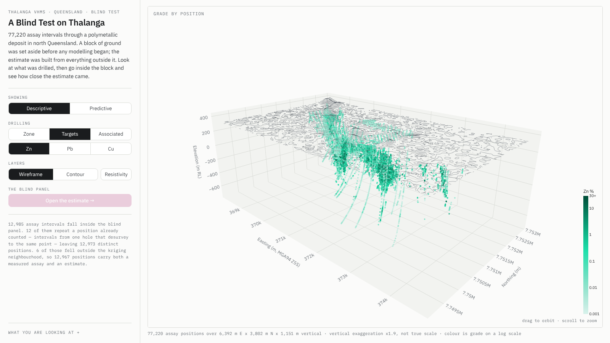
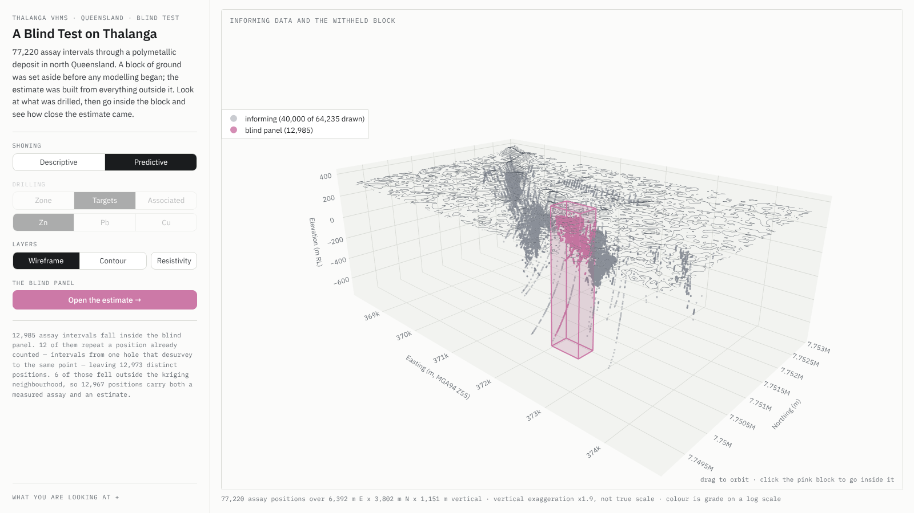
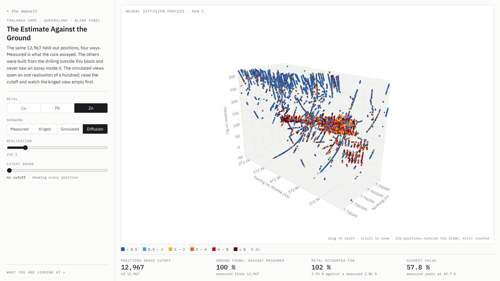

# Thalanga blind-panel demo

An interactive demonstration that a grade estimate can be tested against ground
it never saw. Two static pages: the deposit at regional scale, and the blind
panel at its own scale.

The demonstration answers one question a resource geologist asks of any
estimate. **We withheld a block of drilled ground, estimated it from the rest,
and then opened the envelope. How close was it?**

<p align="center">
  
  
  
</p>

---

## The three acts

**1 · The deposit (Descriptive).** Topography over 77,220 assay intervals. The
Drilling switch colours them three ways:

- **Targets**: one metal at a time, Zn, Pb or Cu, shaded light to dark by
  grade. The hover lists all three grades, then a coloured square for each
  associated element measured above detection at that interval.
- **Zone**: the logged geological zone, with a key and counts.
- **Associated**: one of ten associated elements, chosen from a list, with
  not-assayed and below-detection intervals drawn apart from the measured ones.

The Layers switch draws the ground as a wireframe or a contoured surface, and
adds one of two geophysical surveys:

- **Resistivity**: the dipole-dipole IP and resistivity inversion as vertical
  sections beneath the survey lines, chargeability or resistivity.
- **Gravity**: the 1982 ground gravity survey draped over the terrain, as a
  residual, a band pass or a tilt angle.

This act establishes what the drilling and the surveys actually found before
any modelling is mentioned.

**2 · The blind panel (Predictive).** The same scene, recoloured. A prism of
ground 548 m by 328 m and 960 m deep is set aside and never used. The panel is
a volume rather than a surface patch, which a plan view cannot convey and a
rotatable 3D scene can. The Drilling switch is muted in this act; the
Resistivity layer stays available.

**3 · The estimate against the ground.** Clicking the panel flies the camera
into it and opens the second page. One scene holds the same 12,967 positions,
switched between four views: measured, kriged, simulated (sequential Gaussian
simulation) and diffusion (Neural Diffusion Process). The two ensemble views
open on run 1 and keep the median of all 100 runs one slider step away. The
readout follows the selection and reads em-dash against the measured view,
which has no error to report. At a 6.4 % Zn cutoff the measured ground holds
1,780 positions, kriging finds 6, SGS run 1 finds 1,347 and NDP run 1 finds
2,011.

---

## Tech stack

Everything is generated at build time by Python and shipped as static HTML.
There is no server, no JavaScript build step and no framework.

| layer | choice | why |
|---|---|---|
| build | Python 3.11+ | matches the modelling pipeline |
| data | numpy, pandas, pyarrow | reads the pipeline's parquet, npz and csv directly |
| regional 3D | plotly 7.x (`Surface`, `Scatter3d`, `Mesh3d`) | rotatable scene with no custom rendering |
| panel 3D | plotly 7.x (`Scatter3d`) | same stack as the regional page, so the camera hands over without conversion |
| colour ramps | matplotlib colormaps | sampled to plotly colourscales; not used for plotting |
| gravity drape | scipy (`RegularGridInterpolator`) | samples the terrain elevation under each gravity cell |
| typography | IBM Plex, subset and inlined as data URIs | no webfont request, so the pages render identically offline |
| verification | Playwright + Chromium | dev only; renders both pages headless and checks them |

Output is two self-contained `.html` files. They open by double-click over
`file://` and work equally from any static host. Nothing is fetched at runtime,
so the demo works offline and survives being emailed.

Both pages are laid out to one viewport: a fixed rail carrying the heading,
the controls and the numbers, and the scene filling whatever height is left.
Nothing sits below the fold, because a scene the viewer has to scroll to find
is a scene they stop rotating. When the regional page's controls would overflow
a short window, the blind-panel count sentence steps aside and, if needed, the
spacing tightens. Below 54 rem wide the layout stacks and scrolling returns,
which is the phone case rather than the demo case.

**Why two pages rather than one.** The regional scene spans 6.4 km by 3.8 km.
The blind panel occupies about one twelfth of that footprint, so the panel's
positions drawn inside the regional scene would be a smear, and a single page
would carry both payloads whichever one you were looking at. Separate pages also make the
transition a plain link, which avoids the cross-origin restrictions that stop a
`file://` page from scripting into an embedded one.

**One drilling trace.** The regional page draws the 77,220 positions once. The
page restyles that one trace's colours, sizes, symbols and hover for each metal,
for Zone and for each associated element, so no view sends the positions again.

---

## Repo structure

```
thalanga-demo/
├── README.md
├── requirements.txt
├── data/               the pipeline files go here (not tracked)
│   └── README.md       says which file goes where
├── assets/
│   └── fonts/          10 woff2 subsets, 148 kB; inlined at build time
├── docs/
│   └── screenshots/    the images in this README
├── build.py            entry point; writes dist/
├── dataio.py           loads and aligns the assay and estimate tables, zones, associated elements
├── censor.py           the below-detection rule, applied per element and per file
├── geophys.py          loads the IP-resistivity inversion and clips it to the scene
├── gravity.py          loads the 1982 gravity grids and drapes them over the terrain
├── terrain.py          loads, crops and caches the ground surface
├── palette.py          one palette for both pages
├── fonts.py            reads assets/fonts/ and emits @font-face data URIs
├── scene.py            shared scale, exaggeration, camera, flight
├── scorecard.py        grade-tonnage, head grade, calibration, swath
├── regional.py         acts 1 and 2: DEM, drilling views, IP and gravity surveys, blind panel, box
├── panel_page.py       act 3: payload and page for the blind panel
├── templates/
│   ├── shell.html      regional page: controls, flight, narrative
│   └── panel.html      panel page: scene, controls, readout
└── dist/               generated output
    ├── index.html
    └── panel.html
```

Each module does one thing and is runnable on its own, so a number can be
checked without building the whole site:

- `python dataio.py --assays ...` prints the count ladder, the summary
  statistics and the medians of both ensembles.
- `python scorecard.py ...` prints the grade–tonnage table.
- `python censor.py data/thalanga_modelling.parquet` prints what the
  below-detection rule finds in each associated element.
- `python geophys.py data/<ip csv> --box ...` reports the survey lines and what
  falls inside a given scene.
- `python gravity.py data/<gravity csv> --box ...` reports the three gravity
  grids and how many cells fall inside a given scene.
- `python terrain.py ... --crop ...` reports what survives the crop.
- `python palette.py` runs the colour-vision checks.
- `python fonts.py` reports the subset sizes.
- `python scene.py` confirms each scene draws the exaggeration it states.

`scorecard.py` is the one module the build does not import. It computes the
fuller set of comparisons described under **Scoring** below; the panel page
currently derives its four live numbers in the browser instead, because they
have to follow the cutoff slider. Nothing is broken by that, but it is the
loose end to know about.

---

## Data inputs

The pipeline artifacts stay outside the repo, in `data/`.

| file | holds |
|---|---|
| `thalanga_modelling.parquet` | 77,222 assay intervals: coordinates, split, grades, logged zone, associated elements |
| `thalanga_3d.html` | the gridded ground surface, read back out of the figure |
| `baseline_predictions.parquet` | 12,985 blind-panel rows: OK, IDW, local and global mean |
| `sgs_realizations.npz` | 12,985 × 100 conditional simulations per element |
| `ndp_realizations_all_1.npz` | 12,985 × 100 Neural Diffusion Process draws per element, plus a `row` key (optional) |
| `thalanga_modelling_manifest.json` | blind-panel extent, run provenance |
| `Dipole-Dipole_IP-Res_Inversion_Point_data.csv` | 8,648 IP-resistivity inversion points on 10 lines (optional) |
| `Gravity_1982_Grid_Point_data.csv` | 46,068 cells of 18 gravity grids at 20 m, one column per grid (optional) |

The ground surface is the odd one out. It arrives as the plotly figure
`dxf_surface_3d.py` already writes, because that is where the gridded DEM
exists; re-deriving it from the 168 MB DXF on every build would take 40 seconds
to reproduce a grid that has not changed. `terrain.py` reads it once and caches
a 197 kB npz.

That grid is 52 m cells, which is the resolution of the circulated DEM rather
than of the 917,568-face TIN behind it. Across the 6.4 km regional view the
crop leaves 124 by 74 cells. Regenerating over the drilling window alone with
`dxf_surface_3d.py --grid 500` would give about 11 m cells, and is worth doing
before the demo is shown.

### Alignment contract

None of these files share a primary key, and `(Hole, X, Y, Z)` is **not
unique** — hole `SE796F1920-3` has 13 intervals that desurvey to one point, so
a key join inflates 12,985 rows to 15,169.

For the baseline and SGS exports, `dataio.py` relies on row order and verifies
it position by position against hole name and all three coordinates. A
re-export written in a different order raises `AlignmentError` and names the
first row that disagrees. The build stops rather than producing figures that
look right and are not.

The NDP export carries a `row` array: each sample's row number in the
modelling table. `dataio.py` checks that key sample by sample, so a reordered
NDP export still lands on the right samples. **If the baseline or SGS export is
regenerated, add the same `row` array.** It makes the join a key rather than an
assumption.

The zone and associated-element columns come from the modelling table itself
and are joined back on that same row number, so they need no check of their own.

### The count ladder

Three sample counts appear across the demo. All are correct for what they
describe, and the demo states them rather than leaving a reader to wonder.

| count | meaning |
|---|---|
| 12,985 | assay intervals inside the blind panel |
| 12,973 | distinct positions after co-located intervals collapse |
| 12,967 | positions that also received an estimate; 6 fell outside the kriging neighbourhood |

### Below detection

The associated elements go through `censor.py` before anything draws them.
It applies `below_detection_rule_2026-10-23.md` to the whole modelling table
as one file. A per-job split is not possible, because 74,830 intervals carry no
laboratory job number.

| element | censored | what the page does |
|---|---|---|
| Sb | 64 % | presence only: 2.5 ppm on 54 % of assays sits beside −5 codes, so it is censored at 5 ppm |
| Bi | 67 % | presence only: 2.5 ppm on 51 % of assays, censored at 5 ppm |
| As | 5 % | graded; 5 ppm on 24 % equals a −5 code, so it is a measurement at the limit and the hover says so |
| the other seven | under 2 % | graded |

The 2.5 ppm values are already in the raw `ThalangaML_Assays.csv`, so the
modelling pipeline did not write them.

`FE_PCT_LAB` has 32 negative values in holes TH703, TH705 and TH717 that are
not detection codes: in TH717 they fall by 0.939 per metre to −27.332. The rule
reads them as below detection, and they show as below-detection crosses in the
Fe view. Correcting them belongs upstream.

### The IP survey

The inversion is unpublished (McInnes D, EPM 12969) and is in GDA94 / MGA zone
55. Only the 6,026 points that fall inside the regional scene are drawn, so the
survey never widens the scene; lines 1000ez and 16250ez lie wholly outside it.
The unit of chargeability is not stated in the file and the page shows none.
`ResErr` and `IPErr` are undocumented and not used. Colour limits are the 2nd to
98th percentile of what is drawn: chargeability 0.07 to 41.0, resistivity 9.1 to
10,000 Ω·m on a log scale.

### The gravity survey

`Gravity_1982_Grid_Point_data.csv` holds 18 Geosoft grids of the 1982 ground
gravity survey as reprocessed by McInnes (2021), terrain corrected at 2.62 g/cc,
written out one row per grid cell. The grids carry no projection; the
data-sources workbook files all gravity under GDA94 / MGA zone 55. The page
drapes three grids from the 90 m stream over the terrain:

| switch | grid | unit |
|---|---|---|
| Residual | `Thal_EW_2nd_DS_0090p0` | mGal |
| Band pass | `Thal_EW_2nd_DS_0090p0_Bp` | mGal |
| Tilt | `Thal_EW_2nd_DS_0090p0_Bp_Tilt` | degrees |

The grids carry no units either. mGal comes from the memo, and reading
`0090p0` as a 90 m filter comes from the file name. 41,252 of the 46,068 cells
fall inside the scene, over all but 75 of the 77,220 drill positions. The drape
sits 4 m above the ground and never above the top of the scene, so it cannot
change the scene's extent. The mGal grids are coloured symmetrically about
zero, out to the 98th percentile of the magnitude drawn.

A 2021 survey also exists, as 16 grids covering a strip west of the deposit
that reaches only a tenth of the scene. It is not drawn. Where the two surveys
overlap (1.7 km²) they correlate at 0.06, and the 2021 mGal grids vary 3.6 to
10 times less than the 1982 ones, so a merged map would show a seam and a
change of scale that are not in the ground. The memo places the ore systems in
gravity lows; across the deposit in the 1982 grids, mineralised intervals sit
near the middle of the value range instead.

---

## Conventions

### Vocabulary

The audience is geologists. Machine-learning register is avoided throughout,
in code identifiers as well as on screen.

| not used | used |
|---|---|
| train / holdout split | informing data / blind panel |
| model, prediction | estimate (kriging), realisation (simulation, diffusion) |
| ground truth | measured assays |
| R², RMSE, conditional bias | proportion above cutoff, head grade, calibration |
| feature, target | variable, grade |

### Scoring

Every number on the panel page is one a resource geologist reads without
translation. Four of them sit under the scene and follow both the view and the
cutoff slider:

- **Positions above cutoff**, out of 12,967.
- **Ground found, against measured.** The same count as a percentage of what
  the assays found at that cutoff. At 6.4 % Zn kriging reports 0 %.
- **Metal accounted for.** Mean grade over the panel against the measured mean.
  Kriging carries 38 % of the metal, SGS run 1 82 % and NDP run 1 102 %.
- **Highest value**, against the highest measured assay. Measured peaks at
  49.70 % Zn, kriging at 7.46 %, SGS run 1 at 88.86 % and NDP run 1 at 57.83 %.

Against the measured view the two comparison cells read em-dash. The answer
sheet has no error to report, and a score of 100 % there would invite a reader
to compare numbers of which one is meaningless.

`scorecard.py` computes the fuller set offline, for a slide or a hand-out:
grade–tonnage curves with a P10–P90 band across all 100 realisations, head
grade recovered (measured 2.86 % Zn against kriged 1.09 %), calibration — where
the simulations give a 30–50 % chance of exceeding the cutoff, 30.1 % of those
positions really are above it — and a swath plot binned down elevation.

R² and RMSE are deliberately absent. Scored against individual assays, a
conditional mean always looks poor because it carries none of the nugget
variance, and the resulting negative numbers describe the estimator's purpose
rather than its failure.

### Vertical scale

Horizontal extents dwarf relief, so true scale renders terrain as a flat sheet
and the orebody as a smear. Both pages exaggerate the vertical and **state the
factor applied**, computed from the aspect ratio actually in force rather than
asserted in the title.

The two scenes need different factors. The regional scene is 6,392 m by 3,802 m
by 1,151 m and reads at ×1.94. Its vertical range is set by the drilling, which
reaches −741 m RL, not by the terrain, which spans only 112 m within the crop.
The blind panel is 548 m by 328 m by 960 m,
taller than it is wide, and needs none. The camera flight interpolates between
them, so the panel relaxes into true proportion as the viewer arrives.

### Palette

One palette across both pages, from the Okabe-Ito set, distinguishable under
the common forms of colour blindness.

| meaning | colour |
|---|---|
| Zn | `#009E73` |
| Pb | `#0072B2` |
| Cu | `#D55E00` |
| blind panel | `#CC79A7` |
| informing data | neutral grey |

Element hues are reserved for elements. The informing data is grey rather than
the pipeline's `#4C72B0`, which sits close enough to Pb that a viewer moving
between acts carries the wrong association.

Within one metal, grade is shown by lightness on a log scale from 0.001 % to
30 %, shared across all three metals so a given shade means the same grade
whichever is on screen. Grades above the ceiling take the darkest shade and the
colourbar marks it `30+`.

The descriptive layers have their own colours, all defined in `palette.py`:

| layer | colours |
|---|---|
| zones | mineralised `#E69F00`, footwall `#56B4E9`, hanging wall `#7A5C2E`, intrusive `#1A1A1A`, not logged light grey |
| associated elements | the hues of the pipeline's 06c figure, each as a ramp from a pale tint to a dark shade on a log scale |
| not assayed, below detection | two greys; below detection is also drawn as × |
| IP survey | pale lemon to near-black; dark is high chargeability or low resistivity |
| gravity | violet for lows, white at zero, slate for highs |

`python palette.py` also checks these layers. The IP ramp stays at least ΔE
15.8 from the metals, the panel colour and the greys under normal, deutan and
protan vision, and the zones at least ΔE 31.6 from each other. The gravity
ramp comes within ΔE 8.1 of Zn: every diverging ramp tried came within ΔE 10
of some colour among the metals, zones and greys, and this one keeps the most
distance from the metals and the panel colour. The associated
ramps do not clear ΔE 10 against the two greys: the pale ends sit close to the
not-assayed grey and Fe's middle shades close to the below-detection grey.
Marker size and the × symbol carry that distinction on the page.

---

## Build

Put the pipeline files into `data/`, then:

```bash
pip install -r requirements.txt
python build.py
```

That is the whole command. Each input is found by shape rather than by exact
name, so `data/` can hold whatever the pipeline called them:

| pattern | file |
|---|---|
| `*modelling*.parquet` | assay intervals, coordinates, split, zone, associated elements |
| `*baseline*.parquet` | ordinary kriging, IDW, the mean baselines |
| `*sgs*.npz` | the conditional simulations |
| `*ndp*.npz` | the Neural Diffusion Process draws (optional) |
| `*manifest*.json` | the blind-panel extent |
| `*.html` | the ground surface from `dxf_surface_3d.py` |
| `*IP*.csv` | the IP-resistivity inversion (optional) |
| `*Gravity*1982*.csv` | the 1982 gravity grids (optional) |

A missing or ambiguous required file stops the build and says which one. The
three optional inputs can be left out: without the NDP cube the panel page has
three views, and without the IP survey or the gravity grids the regional page
has no Resistivity or no Gravity layer. Any input can still be pointed at
directly with `--assays`, `--ndp`, `--ip`, `--gravity` and so on, and `--data`
moves the whole folder.

Then open `dist/index.html`.

### Payload budget

The regional page carries the DEM, the 77,220 positions once, the colouring
for every drilling view, the IP survey, the gravity drape and the blind-panel
act: 15.5 MB with plotly embedded. The panel page carries 12,967 positions and six realisations
from each ensemble across three metals: 8.6 MB with plotly embedded. Neither
page loads the other's data.

The full SGS and NDP cubes are 15.6 MB of float32 each across the three
metals and are never shipped.
Summary curves are computed at build time and arrive as a few kilobytes.

---

## Status

| module | state |
|---|---|
| `dataio.py` | done; reproduces the circulated figures exactly; loads zones and associated elements |
| `censor.py` | done; the rule's reference implementation verbatim, plus the at-limit flag and the presence-only call |
| `geophys.py` | done; survey checked on load, clipped to the scene |
| `gravity.py` | done; grids checked on load, draped inside the scene |
| `terrain.py` | done; caches the DEM, crop verified |
| `palette.py` | done; metal check passes, closest pair ΔE 13.9; layer check reports the gravity/Zn and associated/grey closeness above |
| `fonts.py` | done; 148 kB of woff2 subsets, no external request |
| `scene.py` | done; camera mapping verified against rendered pixels |
| `scorecard.py` | done; all four comparisons, 4.6 kB payload — not imported by the build |
| `regional.py` | done; one drilling trace for every view, IP and gravity surveys, both acts, box click verified |
| `panel_page.py` + `templates/panel.html` | done; one scene, four views, fits one viewport |
| `templates/shell.html` | done; Descriptive/Predictive, Drilling and Layers controls, flight, camera handover, fits one viewport |
| `build.py` | done; both pages in about 5 s from a warm DEM cache |

Both pages were rendered headless at 1920×1080, 1600×900, 1536×864, 1440×900,
1366×768 and 1280×720 with the notes collapsed. Neither scrolls at any of
them: the regional page in every drilling view with Resistivity on and off and
with Gravity on, the panel page in all four views. Opening the notes may scroll
the rail, by design. The scene's axis ranges are the same with Gravity on and
off.

What remains:

- Narrative copy reviewed by a geologist.
- A decision on whether `scorecard.py`'s curves belong in the demo or stay a
  hand-out.
- Draw order of the IP sections against the drilling. The page draws the
  sections over the drilling in every view. The approved preview drew them
  over the metals but under the Zone and Associated colouring.
- The Fe values in TH703, TH705 and TH717, to be corrected upstream.
- The units and filter wavelengths of the gravity grids, read here from the
  memo and the file names, to be confirmed with the processor.

### Known risk

The regional page is 15.5 MB, nearly all of it plotly plus the positions, their
colouring and the gravity drape. It opens fine from disk and from a static host, but it is slow
enough over a hotel connection to be worth testing before a live showing.
Building with `--cdn` leaves plotly out of both pages, 4.8 MB each, which
brings the regional page to 10.6 MB and the panel page to 3.8 MB. The cost is
needing internet, which is the wrong trade for a demo that may be shown on
site.
